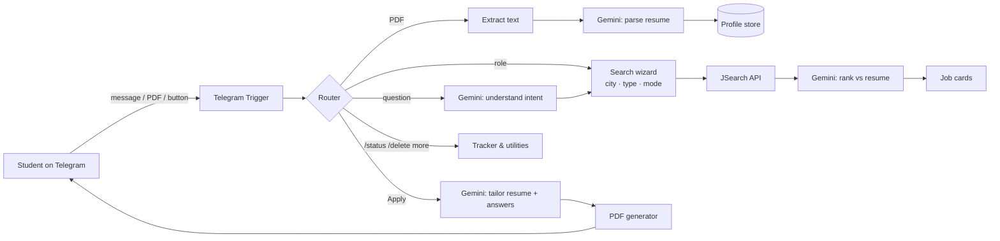
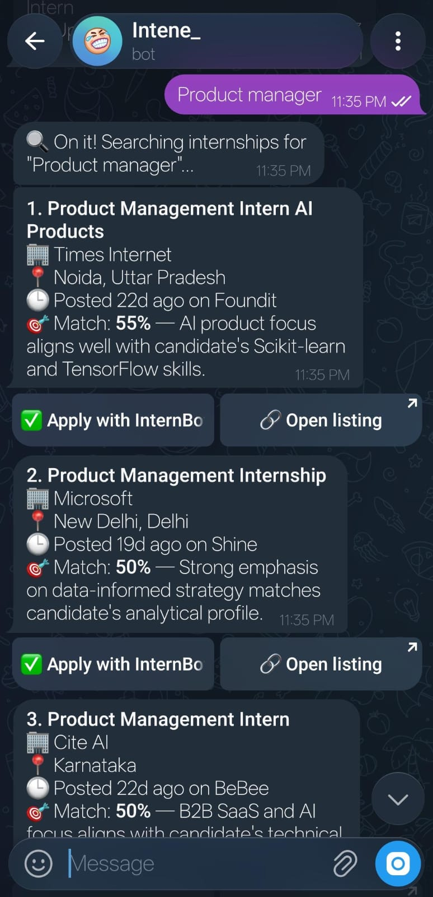
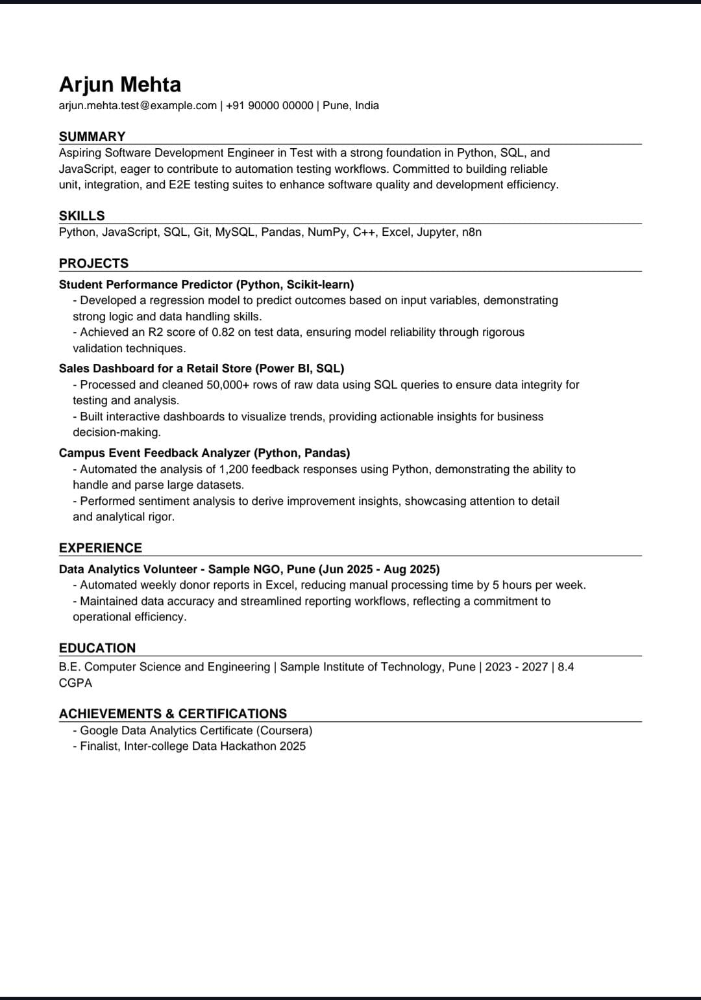
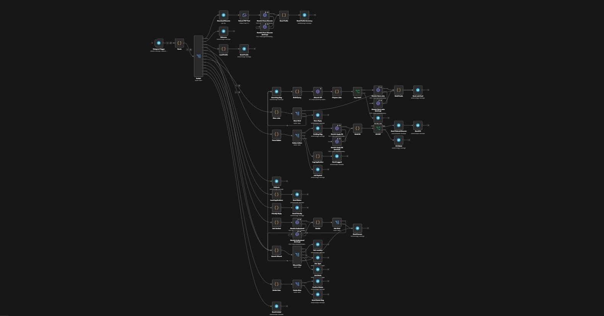

# 🎓 ApplyMate — AI internship finder on Telegram

> Type a role. Get real internships ranked against your resume. Tap **Apply** and get a resume tailored to that exact job — in under 30 seconds, inside Telegram.

Built with **n8n** (no backend code server), **Telegram Bot API**, **Google Gemini** and **JSearch** (LinkedIn, Indeed, Glassdoor & more).


### ▶️ [Click here to watch the demo video](https://1drv.ms/v/c/c2defe87e464a49e/IQA1jrj6fTH1SY699gFlNN3kASHfbxMX_EJ5T-u5oIPXiD8?e=bP4EPv)

---

## 😩 The problem

Students apply to dozens of internships across 5+ portals. For each one they:
1. search every portal separately,
2. guess whether they're a good fit,
3. tweak their resume and rewrite "Why should we hire you?" — again.

Most give up tailoring and spray the same resume everywhere.

## ✨ What ApplyMate does

| | Feature | How |
|---|---|---|
| 📄 | **Reads your resume** | Send a PDF → Gemini extracts skills, projects, CGPA, likely roles |
| 🔍 | **Searches real jobs** | Type *"frontend developer"* → asks city, type (internship/full-time) & work mode → live listings |
| 🎯 | **Match score per job** | Each card shows **Match %** + one-line reason based on *your* resume |
| ➕ | **"more"** | Shows the next results, pages through the API, skips duplicates |
| 🛠️ | **Tailored resume PDF** | Tap **Apply** → resume rewritten for that job (reordered, rephrased — **nothing invented**) |
| ✍️ | **Apply kit** | Ready answers for *Why hire you / Why this role / Best project* + a 3-line recruiter note |
| 📋 | **Tracker** | **Mark as applied** → `/status` lists everything you applied to |
| 💬 | **Talks like a human** | Free-text questions go to an AI that answers or turns them into a search |
| 🔒 | **Privacy & limits** | `/delete` erases your data; daily per-user limits protect free API quotas |

## 🧠 How it works



**Design decisions**
- **Single Telegram webhook → router.** One bot can only have one webhook, so every feature hangs off one Switch.
- **Primary + backup AI model.** Each Gemini call falls back to a second model on quota/overload errors, so one busy model never breaks the bot.
- **No hallucinated resumes.** The tailoring prompt may only reorder/rephrase the candidate's real content; missing job keywords are shown as *suggestions*, never added.
- **PDF generated in pure JavaScript** inside an n8n Code node — no external PDF service.
- **Guardrails:** per-user daily limits (10 searches, 10 tailored resumes, 5 uploads) + a global cap; friendly "busy" messages instead of silent failures.

## 🧰 Tech stack

`n8n` · `Telegram Bot API` · `Google Gemini API` · `JSearch (RapidAPI)` · `Docker` · `Railway` · `JavaScript`

## 🚀 Run it yourself

**You need:** Docker, a Telegram bot token ([@BotFather](https://t.me/BotFather)), a free [Gemini API key](https://aistudio.google.com), a free [JSearch key](https://rapidapi.com) and a public HTTPS URL (Railway, or [ngrok](https://ngrok.com) for local testing).

```bash
git clone https://github.com/<your-username>/internbot.git
cd internbot
cp .env.example .env      # set WEBHOOK_URL to your public https URL
docker compose up -d      # n8n on http://localhost:5678
```

Then in n8n:
1. **Import** `workflow/InternBot.json` (⋯ → Import from file).
2. Create 3 credentials and select them on the nodes:
   - **Telegram API** → bot token
   - **Google Gemini (PaLM) API** → Gemini key
   - **Header Auth** → name `X-RapidAPI-Key`, value = JSearch key
3. Click **Publish**, open your bot, send `/start`.

> API keys live only in n8n's encrypted credential store — none are in this repo.

## 💬 Commands

| Command | What it does |
|---|---|
| `/start` | Welcome + how to use |
| *(send PDF)* | Save / update your profile |
| *any role* | Search, e.g. `data analyst intern Pune hybrid` |
| `more` | Next results |
| `/profile` | Show saved profile |
| `/status` | Applications you marked |
| `/delete` | Erase all your data |

## 📸 Screenshots

| Search & match % | Tailored resume | n8n workflow |
|---|---|---|
|  |  |  |

## 🗺️ Roadmap
- [ ] Daily morning alerts for saved searches
- [ ] Move storage to a database (n8n Data Tables / Postgres)
- [ ] WhatsApp channel
- [ ] Interview-prep questions per job

## 👤 Author
**Sam Tozeen** — [LinkedIn](https://www.linkedin.com/in/sam-tozeen-336216376?utm_source=share_via&utm_content=profile&utm_medium=member_android) · 

Licensed under MIT.
